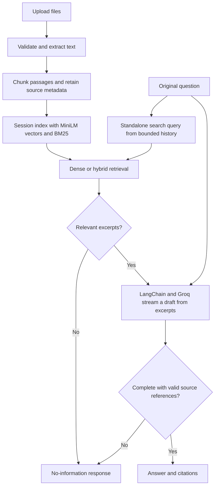

<div align="center">

# CampusGuide

**Ask questions about your documents with retrieval-augmented generation and inspect source-cited answers.**

[](https://www.python.org/)
[](https://streamlit.io/)
[](https://github.com/KOUSHIK1831/CampusGuide/actions/workflows/tests.yml)

[Features](#features) · [Quick start](#quick-start) · [Architecture](#architecture) · [Deploy](#deployment)

</div>

CampusGuide is a Streamlit document-question-answering application. Upload your own files, provide a **Groq API key**, and explore answers grounded in retrieved passages. Document indexes and conversation history are kept in the active Streamlit session, not a shared database.

## Features

- **Bring your own key:** Enter your Groq key in a password-masked sidebar field.
- **Multi-format uploads:** Text-based PDF, DOCX, TXT, Markdown, and JSON.
- **Follow-up questions:** LangChain rewrites a search query using up to four completed question-and-answer turns. The rewritten and original questions are both searched and their evidence is fused, so a poor rewrite cannot hide passages that directly answer the question. If a follow-up still finds no passage, the previous question is added to the search. Generation still answers the original question from retrieved excerpts.
- **Hybrid retrieval:** Combines MiniLM cosine similarity and BM25 lexical matches using reciprocal rank fusion. Once one passage clears the cosine cutoff, nearby lower-scoring passages fill the evidence pool so short follow-ups can reach detail sections instead of only a header chunk. Dense retrieval is available as a baseline, with an optional local cross-encoder for hybrid mode.
- **Streaming and citations:** The UI labels drafts while they stream. The final answer must contain valid citation references to show filenames, PDF pages, and the passages supplied to the model.
- **Session isolation:** Each visitor gets an in-memory document index and conversation. Changing the file selection clears both.
- **Document controls:** Up to 10 files; 15 MB per file and 40 MB combined.
- **Testing and evaluation:** pytest tests, retrieval cases, and GitHub Actions.

> [!IMPORTANT]
> The hosting service processes uploaded files. Groq receives retrieved excerpts for answering and a limited amount of dialogue for rewriting later questions. Keep API keys private and avoid uploading sensitive documents.

## Quick start

**Requirements:** Python 3.12+, internet access to download the embedding model on first use, and a [Groq API key](https://console.groq.com/keys).

```bash
git clone https://github.com/KOUSHIK1831/CampusGuide.git
cd CampusGuide
python -m venv .venv
# Linux/macOS: source .venv/bin/activate
# Windows PowerShell: .venv\Scripts\Activate.ps1
python -m pip install -r requirements.txt
streamlit run app.py
```

Open **http://localhost:8501**. A `.env` file is not required for the interactive app; configuration overrides and local CLI tools can use [`.env.example`](.env.example).

## Using CampusGuide

1. Enter your own Groq API key in the sidebar.
2. Upload files, then select **Process uploaded documents**.
3. Ask a question and inspect the source excerpts accompanying the answer.
4. Choose **Clear my session** to clear the indexed files, API key, and chat history.

Try [`data/examples/campus_faq.md`](data/examples/campus_faq.md) to explore the interface with deliberately fictional sample policies. Cite and verify source documents rather than trusting model answers automatically.

## Architecture



The embedding model defaults to `sentence-transformers/all-MiniLM-L6-v2` and the Groq model to `openai/gpt-oss-20b`. Citation validation checks that the answer references real excerpts in the request. Review each cited passage for factual support.

## Configuration

For CLI workflows or local model overrides, copy `.env.example` to `.env` and review:

| Variable | Use |
| --- | --- |
| `LLM_MODEL` | Groq model name |
| `EMBEDDING_MODEL` | Sentence Transformer model |
| `VECTOR_BACKEND` | Vector backend (default FAISS) |
| `MIN_RETRIEVAL_SCORE` | Dense cosine cutoff that anchors both retrieval modes; hybrid finds still require one passage at or above it |
| `RETRIEVAL_MODE` | Streamlit retrieval strategy, `hybrid` (default) or `dense` |
| `RERANKER_MODEL` | Optional CPU cross-encoder, for example `cross-encoder/ms-marco-MiniLM-L2-v2` |
| `DATA_RAW_PATH`, `VECTOR_STORE_PATH` | Optional local CLI data directories |

The interactive UI accepts the Groq key directly and does not require a shared hosting-provider key.

## Testing

```bash
python -m pip install ".[dev]"
python -m pytest -q
```

The repository also provides [evaluation cases](evaluation/), [deployment notes](docs/DEPLOY.md), and a [roadmap](docs/ROADMAP.md). Tests validate project behavior but do not guarantee the factual correctness of arbitrary AI answers.

## Supported input and index behavior

| Format | How it is processed |
| --- | --- |
| PDF | Extractable text with page metadata; scanned-only pages need OCR elsewhere |
| DOCX | Text from supported document content |
| TXT, Markdown | Text content with source filename |
| JSON | Structured text content supported by the ingestion loader |

Uploads are validated as a **batch**: unsupported extensions, duplicate
filenames, oversize files, and empty extracted text are rejected. A change
in selected files invalidates the previous document index and chat history,
preventing responses from an outdated selection.

The embedding step normalizes vectors for cosine retrieval with FAISS `IndexFlatIP` or the NumPy backend. Hybrid retrieval is anchored by at least one passage at or above the cosine cutoff; it then fills the evidence pool with nearby passages and strong lexical matches below that cutoff. Queries with no confident passage still return no evidence. If the optional cross-encoder fails to load or score candidates, the UI keeps the original hybrid order and reports the fallback.

For TXT, Markdown, extractable PDFs and DOCX, CampusGuide reads explicit `Policy ID:`, `Version:`, and `Effective date:` fields in the first 12 lines of the first extracted page or record. Dates use `YYYY-MM-DD`. The answer prompt uses that metadata to qualify policy comparisons and asks for citations to conflicting guidance when the retrieved evidence cannot resolve it. Filename dates and version labels alone cannot establish policy authority or current validity.

## Retrieval evaluation and maintenance

The default offline benchmark builds an index from the committed manifest. It compares dense, hybrid, and optionally reranked hybrid retrieval under the same conditions, with archived source snapshots and clearly marked fictional fixtures.

```bash
python scripts/evaluate.py --backend numpy --details
python scripts/evaluate.py --backend numpy --reranker-model
```

The evaluator reports passage hits, first relevant rank, full evidence coverage, empty retrieval on negative questions, and warm search latency. Standalone follow-up queries supplied by the fixture are scored separately. See the [benchmark and upgrade report](docs/RAG_UPGRADE.md) for measured results and limitations.

Use `python scripts/ingest.py` to index your own files, then pass `--index data/processed --cases <manifest>` with labels that refer to your corpus.

## Common problems

| Problem | Suggested check |
| --- | --- |
| Nothing to search | Upload a supported, text-extractable document and process it |
| No answer despite an upload | Check whether the relevant passage was extracted and retrieved |
| API authorization error | Check the Groq key entered in the sidebar |
| Model unavailable or rate limited | Verify your account's available Groq models and quota |
| PDF gives empty text | Use a searchable PDF rather than a scanned image-only file |
| Chat resets after editing uploads | This intentionally prevents stale cross-document answers |
| First run loads slowly | The sentence-transformer model may need to download |

> [!TIP]
> For meaningful retrieval evaluation, keep examples with both
> **answerable and unanswerable** questions, and inspect the cited
> passages rather than relying on fluent model responses alone.

## Deployment

See [Streamlit Cloud setup](docs/STREAMLIT_CLOUD.md) or [deployment guide](docs/DEPLOY.md). A [Dockerfile](Dockerfile) and [Render configuration](render.yaml) are also included.

> [!NOTE]
> Session data is temporary. Scanned PDFs without extractable text need OCR elsewhere. There is no user-account system, persistent shared knowledge base, or production security certification.
