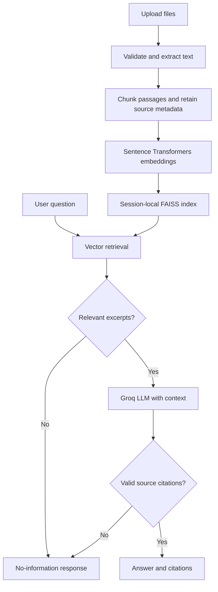

<div align="center">

# CampusGuide

**Ask questions about your documents with retrieval-augmented generation and inspect source-cited answers.**

[](https://www.python.org/)
[](https://streamlit.io/)
[](https://github.com/KOUSHIK1831/CampusGuide/actions/workflows/tests.yml)

[Features](#features) · [Quick start](#quick-start) · [Architecture](#architecture) · [Deploy](#deployment)

</div>

CampusGuide is a Streamlit document-question-answering application. Upload your own files, provide a **Groq API key**, and explore answers grounded in retrieved passages. Document indexes and conversation history are kept in the active Streamlit session, not a shared database.

## Features

- **Bring your own key:** Enter your Groq key in a password-masked sidebar field.
- **Multi-format uploads:** Text-based PDF, DOCX, TXT, Markdown, and JSON.
- **Source citations:** Inspect filenames, PDF page numbers, and matching excerpts.
- **Session isolation:** Each visitor gets an in-memory **FAISS** document index.
- **Grounding checks:** Similarity thresholds and citation validation reject unsupported responses.
- **Document controls:** Up to 10 files; 15 MB per file and 40 MB combined.
- **Testing and evaluation:** pytest tests, retrieval cases, and GitHub Actions.

> [!IMPORTANT]
> Never publish a Groq API key. Uploaded files are processed by the hosting service, and retrieved excerpts are sent to Groq for generation. Do not upload confidential or regulated documents.

## Quick start

**Requirements:** Python 3.12+, internet access to download the embedding model on first use, and a [Groq API key](https://console.groq.com/keys).

```bash
git clone https://github.com/KOUSHIK1831/CampusGuide.git
cd CampusGuide
python -m venv .venv
# Linux/macOS: source .venv/bin/activate
# Windows PowerShell: .venv\Scripts\Activate.ps1
python -m pip install -r requirements.txt
streamlit run app.py
```

Open **http://localhost:8501**. A `.env` file is not required for the interactive app; configuration overrides and local CLI tools can use [`.env.example`](.env.example).

## Using CampusGuide

1. Enter your own Groq API key in the sidebar.
2. Upload files, then select **Process uploaded documents**.
3. Ask a question and inspect the source excerpts accompanying the answer.
4. Choose **Clear my session** to clear the indexed files, API key, and chat history.

Try [`data/examples/campus_faq.md`](data/examples/campus_faq.md) to explore the interface with deliberately fictional sample policies. Cite and verify source documents rather than trusting model answers automatically.

## Architecture



The default embedding model is `sentence-transformers/all-MiniLM-L6-v2`; the default Groq model is `openai/gpt-oss-20b`. A valid citation demonstrates which excerpt was used, **not** that the generated claim is necessarily correct.

## Configuration

For CLI workflows or local model overrides, copy `.env.example` to `.env` and review:

| Variable | Use |
| --- | --- |
| `LLM_MODEL` | Groq model name |
| `EMBEDDING_MODEL` | Sentence Transformer model |
| `VECTOR_BACKEND` | Vector backend (default FAISS) |
| `MIN_RETRIEVAL_SCORE` | Relevance cutoff |
| `DATA_RAW_PATH`, `VECTOR_STORE_PATH` | Optional local CLI data directories |

The interactive UI accepts the Groq key directly and does not require a shared hosting-provider key.

## Testing

```bash
python -m pip install pytest
python -m pytest -q
```

The repository also provides [evaluation cases](evaluation/), [deployment notes](docs/DEPLOY.md), and a [roadmap](docs/ROADMAP.md). Tests validate project behavior but do not guarantee the factual correctness of arbitrary AI answers.

## Supported input and index behavior

| Format | How it is processed |
| --- | --- |
| PDF | Extractable text with page metadata; scanned-only pages need OCR elsewhere |
| DOCX | Text from supported document content |
| TXT, Markdown | Text content with source filename |
| JSON | Structured text content supported by the ingestion loader |

Uploads are validated as a **batch**: unsupported extensions, duplicate
filenames, oversize files, and empty extracted text are rejected. A change
in selected files invalidates the previous document index and chat history,
preventing responses from an outdated selection.

The embedding step normalizes vectors and stores them in a per-session
FAISS `IndexFlatIP` index. Query results are filtered by a relevance
threshold; the generation step uses retrieved excerpts with their
source metadata. Citation validation rejects answers with missing
or invalid source references, but cannot prove factual correctness.

## Retrieval evaluation and maintenance

The repository includes a command-line workflow for indexing a local
corpus and evaluating which source documents the retriever returns.
This is **retrieval evaluation**, not an accuracy score for generated answers.

```bash
python scripts/ingest.py
python scripts/evaluate.py --cases evaluation/demo_cases.json
python -m pytest -q
```

The evaluator reports source hit rates for questions with known expected
sources and the rate of empty retrievals for negative examples. It does
not measure whether an LLM's final wording is correct. See
[`evaluation/`](evaluation/) and [`scripts/evaluate.py`](scripts/evaluate.py).

## Common problems

| Problem | Suggested check |
| --- | --- |
| Nothing to search | Upload a supported, text-extractable document and process it |
| No answer despite an upload | Check whether the relevant passage was extracted and retrieved |
| API authorization error | Check the Groq key entered in the sidebar |
| Model unavailable or rate limited | Verify your account's available Groq models and quota |
| PDF gives empty text | Use a searchable PDF rather than a scanned image-only file |
| Chat resets after editing uploads | This intentionally prevents stale cross-document answers |
| First run loads slowly | The sentence-transformer model may need to download |

> [!TIP]
> For meaningful retrieval evaluation, keep examples with both
> **answerable and unanswerable** questions, and inspect the cited
> passages rather than relying on fluent model responses alone.

## Deployment

See [Streamlit Cloud setup](docs/STREAMLIT_CLOUD.md) or [deployment guide](docs/DEPLOY.md). A [Dockerfile](Dockerfile) and [Render configuration](render.yaml) are also included.

> [!NOTE]
> Session data is temporary. Scanned PDFs without extractable text need OCR elsewhere. There is no user-account system, persistent shared knowledge base, or production security certification.
