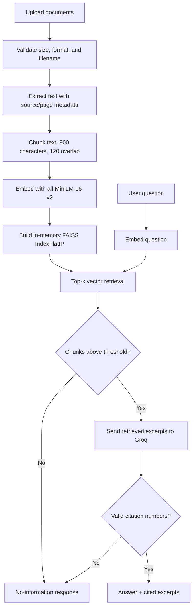

<div align="center">

# CampusGuide

**Chat with your documents using retrieval-augmented generation (RAG).**

Upload PDF, DOCX, TXT, Markdown or JSON files. Bring your own Groq API key, ask questions, and inspect source-cited answers.

[](https://www.python.org/)
[](https://streamlit.io/)
[](https://github.com/KOUSHIK1831/CampusGuide/actions)
[](LICENSE)
[](https://github.com/KOUSHIK1831/CampusGuide/commits/main)
[](https://github.com/KOUSHIK1831/CampusGuide)

[Quick start](#quick-start) · [Architecture](#how-it-works) · [Deployment](#deployment) · [Issues](https://github.com/KOUSHIK1831/CampusGuide/issues)

</div>

> [!IMPORTANT]
> **Bring your own key (BYOK):** Every visitor enters a Groq API key in the app's password field. No shared Groq key is needed on the hosting platform. Never commit, post, or screenshot a real API key.

## Overview

CampusGuide is a Python/Streamlit app for answering questions about **your own uploaded documents**. It extracts text, builds a session-local FAISS index, retrieves relevant passages, and sends those excerpts to a Groq-hosted language model for a cited answer. Files, chat history and the vector index belong to the current Streamlit session; no account or external vector database is needed. The project is intended for learning, demonstrations and document exploration—not high-stakes document processing.

**Demo:** [TODO: Add a verified Streamlit Community Cloud URL]. The existing GitHub repository is [KOUSHIK1831/CampusGuide](https://github.com/KOUSHIK1831/CampusGuide).

## Contents

- [Features](#features)
- [Quick start](#quick-start)
- [Using the app](#using-the-app)
- [How it works](#how-it-works)
- [Repository layout](#repository-layout)
- [Configuration](#configuration)
- [Tests and evaluation](#tests-and-evaluation)
- [Deployment](#deployment)
- [Troubleshooting](#troubleshooting)
- [Limitations and roadmap](#limitations-and-roadmap)

## Features

- **Bring your own Groq API key** through a password-masked input; the app does not persist it to disk.
- **Upload and chat:** PDF (selectable text), DOCX, TXT, Markdown and JSON.
- **Batch validation:** up to 10 files, 15 MB per file, 40 MB combined; duplicate filenames are rejected.
- **Source-cited answers** with filenames, PDF page references and expandable supporting excerpts.
- **Session-isolated search:** one in-memory vector index per Streamlit visitor; the pretrained embedding model is the only globally cached resource.
- **Grounding safeguards:** context-only prompt, retrieval similarity threshold, citation-number checking and no-evidence responses.
- **Local tooling:** optional corpus-indexing CLI, retrieval-evaluation CLI, pytest tests and GitHub Actions.
- **Safe provider errors:** distinct messages for authentication, permission, quota, unavailable-model and network errors without exposing provider payloads.

## Quick start

Requires **Python 3.12+**, Git, internet access for the first embedding-model download, and your own [Groq API key](https://console.groq.com/keys).

```bash
git clone https://github.com/KOUSHIK1831/CampusGuide.git
cd CampusGuide
python -m venv .venv
```

Activate the virtual environment:

- **macOS/Linux:** `source .venv/bin/activate`
- **Windows PowerShell:** `.\.venv\Scripts\Activate.ps1`

```bash
python -m pip install -r requirements.txt
streamlit run app.py
```

Open **http://localhost:8501**. You do **not** need to create a `.env` file to use the interactive application.

## Using the app

1. In the sidebar, enter your **own Groq API key** (not in GitHub, Streamlit Secrets or chat).
2. Upload one or more documents and select **Process uploaded documents**.
3. Wait until the sidebar shows the number of indexed documents and chunks.
4. Ask questions in the chat. Expand citation labels to inspect the original supporting excerpts.
5. Choose **Clear my session** to clear the key, selected files, index and conversation.

**Example:** Upload [`data/examples/campus_faq.md`](data/examples/campus_faq.md), which contains deliberately fictional policies, then ask:

```text
How many library books can students borrow?
```

An illustrative response is:

```text
Students may borrow up to four library books at once [1].
```

The actual model wording can vary. If the files contain no relevant information—for example, if you ask **“Tell me about Koushik”** and none of the uploads mention Koushik—the expected behavior is a refusal, not an invented biography. Retrieval is imperfect; verify any response against its cited passages.

| Supported upload | Notes |
| --- | --- |
| `.pdf` | Must contain extractable text; scanned PDFs require OCR elsewhere |
| `.docx` | Paragraphs and tables |
| `.txt`, `.md`, `.markdown` | UTF-8 text |
| `.json` | Objects, lists or `{"documents": [...]}` |

Changing the selected files invalidates the previous index and chat history. Re-process the selection before continuing.

## How it works



| Component | Responsibility |
| --- | --- |
| [`app.py`](app.py) | Streamlit UI, BYOK input, upload selection, chat and per-session state |
| [`upload_workflow.py`](campusguide_rag/upload_workflow.py) | File limits, duplicate detection, upload fingerprints and chunk preparation |
| [`ingestion.py`](campusguide_rag/ingestion.py) | In-memory text extraction, page metadata and overlapping chunks |
| [`vector_store.py`](campusguide_rag/vector_store.py) | Normalized embeddings, FAISS exact inner-product search and optional NumPy backend |
| [`chatbot.py`](campusguide_rag/chatbot.py) | Groq request, evidence-only prompt, refusal handling, citation validation and safe error reporting |

CampusGuide uses pretrained Sentence Transformers for embeddings; it **does not train or fine-tune a model**. The default embedding model is `sentence-transformers/all-MiniLM-L6-v2`. The current Groq default is **`openai/gpt-oss-20b`**. Groq retired the former `llama-3.1-8b-instant` default for Free/Developer accounts in August 2026; the code automatically maps that old setting to the new model.

> [!NOTE]
> Citations check **which excerpts were referenced**, not whether every generated claim is entailed by an excerpt. Review the source text before relying on an answer.

## Repository layout

```text
CampusGuide/
├── app.py                      # Active web app
├── campusguide_rag/
│   ├── ingestion.py            # PDF/DOCX/TXT/MD/JSON parsing and chunking
│   ├── upload_workflow.py      # Validation and in-memory uploads
│   ├── vector_store.py         # FAISS/NumPy search and CLI persistence
│   └── chatbot.py              # Groq generation and citations
├── tests/                      # Unit and FAISS integration tests
├── scripts/
│   ├── ingest.py               # Optional disk-backed corpus indexing
│   └── evaluate.py             # Offline retrieval evaluation
├── evaluation/demo_cases.json  # Example retrieval questions
├── data/examples/              # Fictional demonstration document
├── data/raw/                   # Legacy local corpus; not loaded by the web UI
├── docs/                       # Hosting, design and roadmap notes
├── .streamlit/config.toml      # Streamlit configuration
├── requirements.txt            # Python runtime dependencies
├── packages.txt                # Linux system dependency for cloud hosting
├── Dockerfile                  # Optional Docker image
└── render.yaml                 # Optional Render configuration
```

The older folders `ingestion/`, `embeddings/`, `retriever/`, `llm/`, `validation/` and `ui/` are retained experiments, **not** the active web pipeline.

## Configuration

Interactive visitors provide their Groq key **inside the UI**; they should not put it in a shared hosting environment.

| Name | Default | Use |
| --- | --- | --- |
| `LLM_MODEL` | `openai/gpt-oss-20b` | Groq generation model |
| `EMBEDDING_MODEL` | `sentence-transformers/all-MiniLM-L6-v2` | Local embedding model |
| `VECTOR_BACKEND` | `faiss` | `faiss` or `numpy` |
| `MIN_RETRIEVAL_SCORE` | `0.30` | Minimum cosine similarity |
| `DATA_RAW_PATH` | `data/raw` | Local CLI input only |
| `VECTOR_STORE_PATH` | `data/processed` | Local CLI output only |

The interactive app builds its index **in memory** and does not use the CLI's disk index.

## Tests and evaluation

```bash
python -m pip install "pytest>=8,<10"
python -m pytest -q
```

The suite tests document parsing, upload validation, vector retrieval, source citations, no-evidence behavior and provider-error handling. Tests use fakes for external model calls; passing tests **do not prove live Groq connectivity**.

For optional disk-based evaluation using only the fictional example:

```bash
python scripts/ingest.py --source data/examples --output data/processed
python scripts/evaluate.py --cases evaluation/demo_cases.json --k 4
```

The evaluator reports source hit@k and an empty-retrieval rate for negative cases. It does **not** measure answer truthfulness or hallucination rates. **[TODO: Publish measured evaluation results and a verified CI run for the current commit.]**

## Deployment

### Streamlit Community Cloud (preferred)

1. Sign in at [share.streamlit.io](https://share.streamlit.io/) with GitHub.
2. Select **Create app** and choose repository `KOUSHIK1831/CampusGuide`, branch `main`, entry point `app.py` and **Python 3.12**.
3. Select **Deploy**, then test the upload → processing → question → cited-answer workflow.
4. Copy the **actual** `*.streamlit.app` address into the demo link at the top of this README.

**No shared Groq key or Streamlit Secrets entry is required.** Every visitor enters their own key. See [Streamlit deployment instructions](docs/STREAMLIT_CLOUD.md).

### Docker (optional)

```bash
docker build -t campusguide .
docker run --rm -p 8501:8501 campusguide
```

The [Render guide](docs/DEPLOY.md) describes an alternative Docker deployment.

## Troubleshooting

| Symptom | What to check |
| --- | --- |
| **Groq rejected the API key (401)** | Generate a fresh key in [Groq Console](https://console.groq.com/keys). Never paste it in an issue or public chat. |
| **Permission denied (403)** | Account access or model eligibility. Check Groq account settings. |
| **Rate limit or quota (429)** | Review Groq usage and try again after your quota resets. |
| **Request rejected (400/404/422)** | Verify `openai/gpt-oss-20b` appears in [supported models](https://console.groq.com/docs/models). Update outdated hosting environment variables. |
| **Network or server failure** | Check connectivity and [Groq status](https://status.groq.com/). |
| **Chat box disabled** | Enter a key, select documents and click **Process uploaded documents**. |
| **No relevant answer** | Check that the answer exists in selectable document text; inspect citations and test a more specific question. |
| **Scanned PDF / memory error** | Use searchable PDFs or smaller files; Streamlit Cloud resources are limited. |

The application intentionally does **not** show raw provider responses in errors because they may contain sensitive information.

## Limitations and roadmap

- Uploads and indexes live only in the current Streamlit session; app restarts can remove them.
- Files pass through the hosting platform, and **retrieved excerpts are sent to Groq**. Do not upload confidential or regulated material.
- No OCR, user login, persistent workspace, global rate limiter or factual-entailment validator is implemented.
- Model output can be inaccurate even with valid-looking citations.
- Planned work includes OCR, richer retrieval evaluation, reranking, better source highlighting and operational security hardening. See [roadmap](docs/ROADMAP.md).

---

Maintained by **Banuri Koushik Reddy** · [GitHub](https://github.com/KOUSHIK1831)

See [CONTRIBUTING.md](CONTRIBUTING.md) for development guidance and [LICENSE](LICENSE) for licensing terms (AGPLv3).
